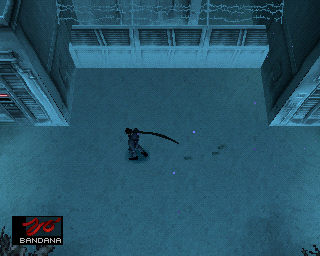

# Metal Gear Solid (PS1) — VOSTFR

🇬🇧 English · 🇫🇷 [Version française](README.md)

**▶ [The project page, with screenshots](https://soaresden.github.io/MGS1-VOSTFR/)**

<p align="center"> </p>

A "VOSTFR" patch for **Metal Gear Solid** on PlayStation: the original **English voices** with **French text and subtitles**.

This repository contains **no game data**: only the scripts that build the images from **your own** PAL France and PAL Europe (English) discs.

## Status

| Part | Status |
|---|---|
| Cutscenes (`DEMO.DAT`): English voices, French subtitles | ✅ done, tested in PCSX-Redux |
| Codec calls (`VOX.DAT` + `RADIO.DAT`): English voices, French text timed to the voice | ✅ done, tested (first Codec call at the dock, Campbell/Naomi at the Snowfield) |
| In-game voices (dialogue during gameplay, Briefing) | ✅ done, tested on both discs' Briefing (same mechanism) |
| Disc 2 | ✅ boots, English voices and French subtitles (Briefing) |
| Disc swap during the game | ⚠️ to be checked on console or DuckStation: PCSX-Redux refuses it, even with the original discs |
| `--carre` option: Square fast-forwards Codec dialogue (like in MGS2) | ✅ done, tested |
| `--m9` option: tranquilizer M9 and PSG1-T (guards fall asleep, zzz) | ✅ done, tested (dock: patrolling guard, alert, 2nd shot, PSG1-T) |
| `--m9` option: silent zzz claymores ("CLAY.ZZZ") | ✅ done, tested (dock: zzz claymore = guard asleep with no noise or alert, normal claymore = guard killed) |
| `--psg1` option: PSG1 (and PSG1-T) usable standing or crouching | ✅ done, tested (dock: standing, crouching, prone, shooting a guard) |
| `--l2r2` option: in first-person view, L2/R2 lean, L2+R2 tiptoe (like in MGS2) | ✅ done, tested |
| `--fps` option: aim and shoot the SOCOM / M9 in first-person view (like in MGS2) | ✅ done, tested (dock: guard put to sleep with the M9, hurt with the SOCOM, laser) |
| `--life TEXT` option: your own text instead of "LIFE" in the life bar (e.g. "SNAKE") | ✅ done, tested (dock, French and English versions) |
| `--cartes` option: key card doors open with the card in your inventory (no need to equip it), and the card then equips itself (its icon shows) | ✅ done, tested (Blast Furnace LV.6 door; cave LV.5 door: LV.7 CARD icon) |
| `--psg1loup` option: the PSG1 in the cave, where Meryl was waiting (no trip back to the armory) | ✅ done, tested in game (pickup, Campbell's call, fight without Meryl on the way back) |
| `--bandana` option: the bandana shows, with a very long tail flowing behind Snake (like in MGS2) | ✅ prototype, tested (Snowfield French and English, Blast Furnace: tail at rest, running, equip / unequip) |
| `--titre` option: "METAL GEAR SOLID - SHADOW FIXES" title screen, by Soaresden, v1.0 | ✅ done, tested ("PRESS START BUTTON" screen and menu) |
| Web page: build in the browser, options to tick, works offline | ✅ done, same images as Python byte for byte |
| French dub credits in the intro → English cast | 🔧 to do |
| `--combine` option: both discs in **a single image** (emulators, lighter sound) | ✅ done, tested in PCSX-Redux (intro, Codec on both discs, switch to disc 2 from a save, no disc change); VOSTFR, VF and EN, all options |

## Required discs

| Version | Disc 1 | Disc 2 |
|---|---|---|
| France | SLES-01506 | SLES-11506 |
| Europe (English) | SLES-01370 | SLES-11370 |

As CHD (like in Batocera) or BIN/CUE. No chdman needed: the CHD is read directly in Python, and its raw SHA-1 is checked.

## Usage

### The easy way: the web page

**[soaresden.github.io/MGS1-VOSTFR](https://soaresden.github.io/MGS1-VOSTFR/#fabriquer)**: drop your discs (CHD or BIN), choose the version and the options, and the page builds the images **in your browser**. Three versions to choose from: **VOSTFR** (French + European discs), **original French version + mods** (French discs only) or **original English version + mods** (European discs only; the texts added to the weapon menu are in English). Nothing is uploaded: everything happens on your computer, and the images are written to the folder you choose (Chrome or Edge recommended, about 3 GB of free memory, a few minutes).

The page also works **offline**: download the project ([zip](https://github.com/soaresden/MGS1-VOSTFR/archive/refs/heads/main.zip)), unzip it and double-click `index.html`.

It uses `docs/mgs-vostfr.js`, a JavaScript port of the Python scripts: on the same discs, the images are **byte-for-byte identical** to those of `build.py` (checked with `tools/webtest.js`). The options are byte differences exported by `tools/webpatches.py` to `docs/patches.js`: **run it again after changing an option** (`python tools/webpatches.py work/FR1.bin work/FR2.bin work/UK1.bin work/UK2.bin`).

### From the command line

Python 3.10+ with `numpy`.

Without the VOSTFR, just the mods on your original game: `--vf` (French discs, `--fr1/--fr2`) or `--vo` (European English discs, `--uk1/--uk2`), with at least one option. Example: `python build.py --vf --m9 --fps --fr1 ... --fr2 ... --out ../work/out` gives `Metal Gear Solid (VF) (Disc 1/2)`.

```bash
cd tools
python build.py --fr1 "MGS (France) (Disc 1).chd" --uk1 "MGS (Europe) (Disc 1).chd" --fr2 "MGS (France) (Disc 2).chd" --uk2 "MGS (Europe) (Disc 2).chd" --out ../work/out
```

Output: `Metal Gear Solid (VOSTFR) (Disc 1).bin/.cue`, `(Disc 2)` and an `.m3u` for disc swapping in emulators. It takes about a minute and a half and needs 2 GB of free memory.

`--carre` option: during a Codec call, **Square** cuts the voice and runs through all remaining lines at once, as if you were mashing the button (X keeps its original role: it cuts the voice, then one line per press). Choices (save, yes/no) are not skipped. At the end of a call skipped with Square, the Codec closes and you are back in the game (without the patch, a call the player picked up ends on the frequency screen). The patch also works on its own, on an image you already built:

```bash
python carre.py "Metal Gear Solid (VOSTFR) (Disc 1).bin" "Metal Gear Solid (VOSTFR) (Disc 2).bin"
```

`--m9` option: a **tranquilizer M9** (and a **PSG1-T**) to finish the game without killing.
- You get it when you pick up the SOCOM ("SOCOM + M9" message); the PSG1-T comes with the PSG1.
- In the weapon menu (R2), on the SOCOM, **Triangle** switches to the M9 ("M9" name, bluish icon) and back. Same on the PSG1 (PSG1-T) and the claymores (CLAY.ZZZ). The menu's description box then explains what the new weapon does (in French, like the rest of the game). The four directions already move through this menu. R1 (equip / put away) keeps the choice, which is also stored in the save.
- Ammo is shared with the original weapon: SOCOM ammo also fills the M9. Always silenced, one shot at a time, **one dart loaded at a time** (magazine of 1). On screen, the weapon in hand is the silenced SOCOM.
- Patrolling guard: asleep after **1 shot**, for good (he does not wake up), with **zzz** above him. No blood, no life lost, not counted as a kill.
- **Meryl** (when she follows Snake in the basement and in the cave): put to sleep too, but she gets up on her own about 5 s later (otherwise the game would be stuck). Otacon and Meryl at the end of the game (parking lot, jeep) cannot be hit, as in the original game.
- **Wolf dogs** (cave, snowfield): asleep after 1 shot, for good (they lie down, zzz), without dying. Zzz claymores put them to sleep too.
- During an alert or a search: the 1st shot **shakes** him; he falls asleep **8 s** later, or right away on the 2nd shot.
- Bosses, cameras, etc.: same damage as the original weapon (Sniper Wolf with the PSG1-T, for example).
- **Zzz claymores**: on the CLAYMORE slot, Triangle switches to zzz claymores ("CLAY.ZZZ" name, bluish icon) and back. Shared ammo ("CLAYMORE + ZZZ" message on pickup). What counts is the mode when the mine is **planted**: a planted zzz claymore stays zzz. A soldier who sets it off (or is caught in the blast) falls asleep at once, even during an alert, for good and without losing life. Other targets (Raven, Snake...) take normal claymore damage.
- A zzz claymore is **silent**: no blast sound, no flash or fireball, invisible fragments, and the other guards hear nothing. Just a small "pfft" and a puff of smoke. Normal claymores are as loud as ever.
- The soldier code is patched in 33 of the 36 stages that have soldiers (3 stages with no recognised "knocked down" soldier: s03c, s12b, s12c).
- ⚠️ After a new version of the images, resume from a **memory card save** (Codec), not from an emulator save state: a state keeps the program of the old image (for example, Triangle does not switch claymores with a state made before they were added).

```bash
python m9.py "Metal Gear Solid (VOSTFR) (Disc 1).bin" "Metal Gear Solid (VOSTFR) (Disc 2).bin"
```

`--psg1` option: the **PSG1** (and the `--m9` PSG1-T) can be used **standing or crouching**, without Snake lying down.
- Standing, Snake shoulders the rifle and the scope is at eye level (like the Triangle first-person view). Crouching, the scope is lower. Prone, nothing changes from the original game.
- Snake keeps the stance he had when drawing the PSG1. In the scope, **X** switches between standing and crouching. To aim prone: lie down first, then draw the PSG1.
- The original game also put Snake back on his belly after some scenes (end of a scripted scene, back from a call…) when the PSG1 was in hand: not anymore.
- Standing or crouching, you can aim a bit higher and lower than prone, and the scope **sways like when prone**, twice as much standing (you are less steady), the same crouching; the shot follows the scope. **Diazepam** removes the sway, as when prone. The heartbeat is still felt in the controller.
- With `--m9`, apply `m9.py` **before** `psg1.py` (build.py does it in the right order).

```bash
python psg1.py "Metal Gear Solid (VOSTFR) (Disc 1).bin" "Metal Gear Solid (VOSTFR) (Disc 2).bin"
```

`--l2r2` option: first-person view (holding Triangle) like in MGS2.
- **L2** makes Snake lean left and **R2** lean right to look around a corner. In the original game only L1/R1 do it (they still work).
- While leaning, the **arrows still turn the view** (the original game locked it).
- **L2 + R2 together**: Snake stands on **tiptoe**, the view rises about 20 cm to look over an obstacle.
- X crouches / stands up in first-person view: the original game already did that.

```bash
python l2r2.py "Metal Gear Solid (VOSTFR) (Disc 1).bin" "Metal Gear Solid (VOSTFR) (Disc 2).bin"
```

`--fps` option: **aim and shoot in first-person view** with the SOCOM or the M9, like in MGS2.
- SOCOM or M9 in hand, **Triangle** held: normal first-person view, no weapon.
- **Square** held: the weapon shows at the bottom right of the screen with the **red laser** (a beam from the weapon to the aimed spot, with the red dot at the end); **Square** released: the shot goes off in the direction of the view (Left/Right turn, Up/Down tilt the view as usual).
- It is the game's normal shot: sound, noise, ammo; the M9 keeps its tranquilizer effect (`--m9`). Like in the normal view: the aiming sound when you start holding Square, and a real reload when the magazine is empty (magazine sound, same rate of fire as in the normal view: no rapid fire). The shot goes exactly along the view axis, from the same point as the PSG1's shot in the scope: it hits the same spot. To shoot up or down, keep the direction held while releasing Square (otherwise the view goes back to level, as in the original game).
- Works with `--m9`, `--l2r2`, `--psg1` and `--carre` (build.py applies `fps.py` after `m9.py`).

```bash
python fps.py "Metal Gear Solid (VOSTFR) (Disc 1).bin" "Metal Gear Solid (VOSTFR) (Disc 2).bin"
```

`--life TEXT` option: replaces the word **"LIFE"** of the life bar with the text of your choice, for example `--life SNAKE`. Without the option (or with `LIFE`), nothing changes.
- Same font and same frame as the original "LIFE" (the frame grows with the text). The text also shows on the life bar of the weapon and item menus.
- **15 characters at most**: letters (shown in capitals; accents are removed: "é" becomes "E"), digits, space and `. : ! ? + - = % ( )`. The game's font has nothing else.
- Works with all the other options (it only changes text).

```bash
python life.py "SNAKE" "Metal Gear Solid (VOSTFR) (Disc 1).bin" "Metal Gear Solid (VOSTFR) (Disc 2).bin"
```

 

`--cartes` option: key card doors open as soon as the card is in your inventory, no need to equip it in the item menu. The card level still matters (a LV.3 card does not open a LV.5 door). So you can see the card was used, it equips itself when the door opens: its icon (with the level) shows up in the item box, bottom left, and stays there. It therefore replaces whatever item Snake was holding, even when a guard is the one opening the door. On most doors, the red light and the "denied" beep now come as soon as you present a card that is too weak, equipped or not. Three doors (two in the commander's room, one in Nuke Building B2) have no room left in their script: they open without equipping the card, with no icon.

 


`--psg1loup` option (off by default): after Sniper Wolf shoots Meryl in the underground passage, no need to go all the way back to the armory for the PSG1. After Campbell's call sending Snake for the PSG1, just step back out into the wolf-dog cave: the PSG1 waits **where Meryl was waiting with the dog**. Picking it up triggers Campbell's armory call (use it on Sniper Wolf), and back in the passage Meryl is gone: the fight starts, as in the original game. One visible detail: the PSG1 is already in the inventory (empty) when you enter the cave, and the box brings the bullets. The game has no "weapon on the floor" model in that room, only the ammo box one, and it refuses ammo without the weapon. The box also shows up in Extreme mode; the armory route still works.


```bash
python cartes.py "Metal Gear Solid (VOSTFR) (Disc 1).bin" "Metal Gear Solid (VOSTFR) (Disc 2).bin"
python psg1loup.py "Metal Gear Solid (VOSTFR) (Disc 1).bin"
```

`--bandana` option (prototype): in the original game, equipping the BANDANA (infinite ammo, earned by finishing the game) barely shows: the headband Snake already wears just gets a bit darker. With this option, the bandana gets a **1.30 m long tail** tied behind the head, like in MGS2: it hangs down his back when Snake stands still, lifts up behind him when he runs, and waves. It is the small tail model Konami left on the disc and never displayed, made longer and animated. Simple animation: the tail follows the head and ignores the scenery (with Snake lying down, it can go through the floor).

 

```bash
python bandana.py "Metal Gear Solid (VOSTFR) (Disc 1).bin" "Metal Gear Solid (VOSTFR) (Disc 2).bin"
```

`--titre` option: the title screen becomes this version's own. Under "METAL GEAR", the light band reads **"SOLID - SHADOW FIXES"** (a nod to Shadow Moses), with the letters redrawn in the original colours, and **"by Soaresden  v1.0"** shows just above the menu. Only two title images are redrawn (the logo and Snake's face); the rest of the screen is unchanged.


```bash
python titre.py "Metal Gear Solid (VOSTFR) (Disc 1).bin" "Metal Gear Solid (VOSTFR) (Disc 2).bin"
```

### One image for emulators ("CD Combiner", `--combine` option)

`--combine` adds a **"(1 CD)"** image: the whole game on one disc, **no disc change ever**. The game moves on to disc 2 by itself, without the "Insert disc 2" screen; a disc 2 save loads directly.

⚠️ **Emulators only** (Batocera, DuckStation, SwanStation, RetroArch…): the image is **~990 MB**, too big for a burnt CD (700 MB). On a real PS1, keep the 2-disc images.

⚠️ **The sound is lighter.** A CD cannot go past 99 minutes: that is the limit of the address the game sends to the drive (and DuckStation refuses anything beyond). Both discs take ~1.17 GB even when sharing what they have in common, and the image must stay under ~1.05 GB. To make room:
- **voices** (Codec, in-game voices): 22 kHz → **11 kHz**; you can hear it (a bit more muffled), but it does not get in the way;
- **cutscenes**: 33 kHz → **22 kHz**; almost inaudible (they have next to nothing above 11 kHz);
- movies (archive footage), texts, subtitles, graphics: **unchanged**.

Listen (same passage, before / after): Codec voice [original](docs/previews/combine_codec_original.wav) · [lighter](docs/previews/combine_codec_allege.wav) — intro cutscene [original](docs/previews/combine_cinematique_original.wav) · [lighter](docs/previews/combine_cinematique_allege.wav).

```bash
python build.py --fr1 ... --uk1 ... --fr2 ... --uk2 ... --out ../work/out --combine      # VOSTFR (+ any options)
python combine.py "Metal Gear Solid (VOSTFR) (Disc 1).bin" "Metal Gear Solid (VOSTFR) (Disc 2).bin"   # from 2 existing images
```

Result: `Metal Gear Solid (VOSTFR) (1 CD).bin/.cue` (or `(VF)`, `(EN)`), on top of the two discs. Works with the three versions and all options. Allow 3 to 4 extra minutes (sound re-encoding). Memory card saves from the 2-disc images work as they are.

 

Give **both discs**: disc 2's sound test table is also used to pair disc 1's voices exactly.

## How it works

### Cutscenes

In both PAL versions, every cutscene in `DEMO.DAT` has **exactly the same sequence of audio blocks** (same count, same size): the French dub was fitted to the length of each scene. We keep the French `DEMO.DAT` (subtitles, animations) and copy the English audio into it block by block. The French subtitles land right on the English lines.

### Codec and in-game voices

Here the two dubs have different lengths: the English `VOX.DAT` is 196 MB against 182 MB in French (disc 1).

1. **Pairing the voices**: both `VOX.DAT` files store their ~1100 banks in the same order, with a few extra banks on the English side. The game contains a sound test table (`vc000101` → bank) with the same names in FR and UK: exact pairing on disc 2, carried over to disc 1 through the banks both discs share. The rest is aligned by dynamic programming (audio length, subtitle count), then checked against the Codec calls in the script.
2. **New `VOX.DAT`**: each English bank (voice and lip movements) gets the French subtitles (same number of lines as the French bank, French font), with the English version's timings. In the Codec, each subtitle moves on to the next line of the French `RADIO.DAT` script, so the text follows the English voice.
3. **Renumbering**: the VOX codes (position in the file) of the VOICE commands in `RADIO.DAT` and of the `STAGE.DIR` scripts are rewritten. In `STAGE.DIR`, the scripts (GCL bytecode) are parsed exactly (`tools/gcx.py`): only real codes are changed, never data (textures, models). The hidden sound test (`sound` stage) holds disc 2 codes: it is only renumbered on disc 2.
4. **Disc image**: `VOX.DAT` grows, so `ZMOVIE.STR` and `DUMMY3M.DAT` are shifted (raw sectors copied), the ISO 9660 directory records and the volume size are rewritten, and EDC/ECC recomputed. The game finds its files by name at boot: no other address to fix.

Two lines on disc 2 only exist in French (one of them a German leftover on the French disc): they stay in French.

### One image (`combine.py`)

1. **Sound**: every bank of `VOX.DAT` and `DEMO.DAT` is decoded (SPU ADPCM), filtered and resampled (integer-coefficient filter, same result in Python and JavaScript), re-encoded, then put back together with its subtitles, lip movements and animation data, which do not change. Subtitles follow a clock, not the samples: they stay in sync.
2. **Codes**: voices and cutscenes are referred to by their position in the file; they move, so the codes in `RADIO.DAT` and in the `STAGE.DIR` scripts are rewritten. The scripts (GCL bytecode) are parsed exactly (`tools/gcx.py`): no false positives.
3. **Two directories**: `MGS/` (disc 1) and `MGS2/` (disc 2) on the same image. The game finds its files by name at boot and at each disc change: the EXE picks the directory from the current disc number. The disc change screen (`change`, `abst`, `title`, `demosel` overlays) no longer waits for the lid and hands the game the disc it wants. The game's voice player did not know 11 kHz: two instructions patched.
4. **Image**: files of both discs one after the other (BRF.DAT and FACE.DAT, identical, shared), `DUMMY3M.DAT` (padding) dropped, ISO 9660 tables updated: 420,719 sectors, under the 449,850 limit.

## Tools

| Script | Purpose |
|---|---|
| `tools/build.py` | Builds the VOSTFR images |
| `tools/chd2bin.py` | CHD v5 → BIN/CUE (cdlz, cdzl), SHA-1 check |
| `tools/psxiso.py` | List, extract, EDC-check a PS1 image |
| `tools/cdsector.py` | Mode 2 Form 1 EDC/ECC (numpy), in-place file rewrite |
| `tools/isorebuild.py` | Rebuilds an image with files of a different size |
| `tools/vox.py` | `VOX.DAT` / `DEMO.DAT` banks: blocks, subtitles |
| `tools/voxalign.py` | Pairs the French and English VOX banks |
| `tools/vox_vostfr.py` | New `VOX.DAT`, `RADIO.DAT` and `STAGE.DIR` renumbering |
| `tools/radio.py` | `RADIO.DAT` codec script (TALK / VOICE commands) |
| `tools/demo_vostfr.py` | Cutscene audio replacement |
| `tools/carre.py` | Optional patch: Square fast-forwards the Codec |
| `tools/m9.py` | Optional patch: tranquilizer M9 and PSG1-T |
| `tools/psg1.py` | Optional patch: PSG1 standing or crouching |
| `tools/l2r2.py` | Optional patch: first-person view, L2/R2 lean, L2+R2 tiptoe |
| `tools/fps.py` | Optional patch: shoot the SOCOM / M9 in first-person view |
| `tools/life.py` | Optional patch: your text instead of "LIFE" in the life bar (+ preview) |
| `tools/cartes.py` | Optional patch: key card doors open without equipping the card, which then equips itself |
| `tools/psg1loup.py` | Optional patch: the PSG1 in the cave, where Meryl was waiting, before Sniper Wolf |
| `tools/bandana.py` | Optional patch: visible bandana, very long animated tail (like MGS2) |
| `tools/titre.py` | Optional patch: "Shadow Fixes" title screen, by Soaresden, v1.0 |
| `tools/combine.py` | Both discs in a single image (lighter sound, no disc change); also in the web page ("CD Combiner" box) |
| `tools/spuadpcm.py` | SPU ADPCM: decoding, encoding, integer resampling |
| `tools/gcx.py` | Exact parsing of the `STAGE.DIR` GCX scripts (voice and cutscene codes) |
| `tools/mips.py` | Small MIPS (R3000) assembler for the patches |
| `tools/pal.py` | EXE version (PAL France or PAL Europe English) and translation of the patch addresses |
| `tools/palmap.py` | Development tool: generates `tools/pal_uk.py` (FR → UK addresses) |
| `tools/emu.py`, `tools/emu_drive.lua` | Automated testing in PCSX-Redux (screenshots) |
