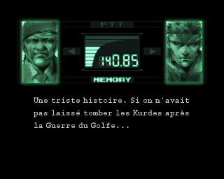
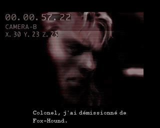

# Metal Gear Solid (PS1) — VOSTFR

🇬🇧 English · 🇫🇷 [Version française](README.md)

**▶ [The project page, with screenshots](https://soaresden.github.io/MGS1-VOSTFR/)**

<p align="center"> </p>

A "VOSTFR" patch for **Metal Gear Solid** on PlayStation: the original **English voices** with **French text and subtitles**.

This repository contains **no game data**: only the scripts that build the images from **your own** PAL France and PAL Europe (English) discs.

## Status

| Part | Status |
|---|---|
| Cutscenes (`DEMO.DAT`): English voices, French subtitles | ✅ done, tested in PCSX-Redux |
| Codec calls (`VOX.DAT` + `RADIO.DAT`): English voices, French text timed to the voice | ✅ done, tested (first Codec call at the dock, Campbell/Naomi at the Snowfield) |
| In-game voices (dialogue during gameplay, Briefing) | ✅ done, tested on both discs' Briefing (same mechanism) |
| Disc 2 | ✅ boots, English voices and French subtitles (Briefing) |
| Disc swap during the game | ⚠️ to be checked on console or DuckStation: PCSX-Redux refuses it, even with the original discs |
| `--carre` option: Square fast-forwards Codec dialogue (like in MGS2) | ✅ done, tested |
| `--m9` option: tranquilizer M9 and PSG1-T (guards fall asleep, zzz) | ✅ done, tested (dock: patrolling guard, alert, 2nd shot, PSG1-T) |
| `--m9` option: silent zzz claymores ("CLAY.ZZZ") | ✅ done, tested (dock: zzz claymore = guard asleep with no noise or alert, normal claymore = guard killed) |
| `--psg1` option: PSG1 (and PSG1-T) usable standing or crouching | ✅ done, tested (dock: standing, crouching, prone, shooting a guard) |
| `--l2r2` option: in first-person view, L2/R2 lean, L2+R2 tiptoe (like in MGS2) | ✅ done, tested |
| `--fps` option: aim and shoot the SOCOM / M9 in first-person view (like in MGS2) | ✅ done, tested (dock: guard put to sleep with the M9, hurt with the SOCOM, laser) |
| French dub credits in the intro → English cast | 🔧 to do |
| "2 discs in 1" version | 💡 phase 3 |

## Required discs

| Version | Disc 1 | Disc 2 |
|---|---|---|
| France | SLES-01506 | SLES-11506 |
| Europe (English) | SLES-01370 | SLES-11370 |

As CHD (like in Batocera) or BIN/CUE. No chdman needed: the CHD is read directly in Python, and its raw SHA-1 is checked.

## Usage

Python 3.10+ with `numpy`.

```bash
cd tools
python build.py --fr1 "MGS (France) (Disc 1).chd" --uk1 "MGS (Europe) (Disc 1).chd" --fr2 "MGS (France) (Disc 2).chd" --uk2 "MGS (Europe) (Disc 2).chd" --out ../work/out
```

Output: `Metal Gear Solid (VOSTFR) (Disc 1).bin/.cue`, `(Disc 2)` and an `.m3u` for disc swapping in emulators. It takes about a minute and a half and needs 2 GB of free memory.

`--carre` option: during a Codec call, **Square** cuts the voice and runs through all remaining lines at once, as if you were mashing the button (X keeps its original role: it cuts the voice, then one line per press). Choices (save, yes/no) are not skipped. At the end of a call skipped with Square, the Codec closes and you are back in the game (without the patch, a call the player picked up ends on the frequency screen). The patch also works on its own, on an image you already built:

```bash
python carre.py "Metal Gear Solid (VOSTFR) (Disc 1).bin" "Metal Gear Solid (VOSTFR) (Disc 2).bin"
```

`--m9` option: a **tranquilizer M9** (and a **PSG1-T**) to finish the game without killing.
- You get it when you pick up the SOCOM ("SOCOM + M9" message); the PSG1-T comes with the PSG1.
- In the weapon menu (R2), on the SOCOM, **Triangle** switches to the M9 ("M9" name, bluish icon) and back. Same on the PSG1. The four directions already move through this menu. R1 (equip / put away) keeps the choice, which is also stored in the save.
- Ammo is shared with the original weapon: SOCOM ammo also fills the M9. Always silenced, one shot at a time, **one dart loaded at a time** (magazine of 1). On screen, the weapon in hand is the silenced SOCOM.
- Patrolling guard: asleep after **1 shot**, for good (he does not wake up), with **zzz** above him. No blood, no life lost, not counted as a kill.
- During an alert or a search: the 1st shot **shakes** him; he falls asleep **8 s** later, or right away on the 2nd shot.
- Bosses, cameras, etc.: same damage as the original weapon (Sniper Wolf with the PSG1-T, for example).
- **Zzz claymores**: on the CLAYMORE slot, Triangle switches to zzz claymores ("CLAY.ZZZ" name, bluish icon) and back. Shared ammo ("CLAYMORE + ZZZ" message on pickup). What counts is the mode when the mine is **planted**: a planted zzz claymore stays zzz. A soldier who sets it off (or is caught in the blast) falls asleep at once, even during an alert, for good and without losing life. Other targets (Raven, Snake...) take normal claymore damage.
- A zzz claymore is **silent**: no blast sound, no flash or fireball, invisible fragments, and the other guards hear nothing. Just a small "pfft" and a puff of smoke. Normal claymores are as loud as ever.
- The soldier code is patched in 33 of the 36 stages that have soldiers (3 stages with no recognised "knocked down" soldier: s03c, s12b, s12c).
- ⚠️ After a new version of the images, resume from a **memory card save** (Codec), not from an emulator save state: a state keeps the program of the old image (for example, Triangle does not switch claymores with a state made before they were added).

```bash
python m9.py "Metal Gear Solid (VOSTFR) (Disc 1).bin" "Metal Gear Solid (VOSTFR) (Disc 2).bin"
```

`--psg1` option: the **PSG1** (and the `--m9` PSG1-T) can be used **standing or crouching**, without Snake lying down.
- Standing, Snake shoulders the rifle and the scope is at eye level (like the Triangle first-person view). Crouching, the scope is lower. Prone, nothing changes from the original game.
- Snake keeps the stance he had when drawing the PSG1. In the scope, **X** switches between standing and crouching. To aim prone: lie down first, then draw the PSG1.
- The original game also put Snake back on his belly after some scenes (end of a scripted scene, back from a call…) when the PSG1 was in hand: not anymore.
- Standing or crouching, you can aim a bit higher and lower than prone, and the scope **does not sway** (in the game, the sway is a prone animation). The heartbeat is still felt in the controller.
- With `--m9`, apply `m9.py` **before** `psg1.py` (build.py does it in the right order).

```bash
python psg1.py "Metal Gear Solid (VOSTFR) (Disc 1).bin" "Metal Gear Solid (VOSTFR) (Disc 2).bin"
```

`--l2r2` option: first-person view (holding Triangle) like in MGS2.
- **L2** makes Snake lean left and **R2** lean right to look around a corner. In the original game only L1/R1 do it (they still work).
- While leaning, the **arrows still turn the view** (the original game locked it).
- **L2 + R2 together**: Snake stands on **tiptoe**, the view rises about 20 cm to look over an obstacle.
- X crouches / stands up in first-person view: the original game already did that.

```bash
python l2r2.py "Metal Gear Solid (VOSTFR) (Disc 1).bin" "Metal Gear Solid (VOSTFR) (Disc 2).bin"
```

`--fps` option: **aim and shoot in first-person view** with the SOCOM or the M9, like in MGS2.
- SOCOM or M9 in hand, **Triangle** held (first-person view): the weapon shows at the bottom right of the screen.
- **Square** held: the **red laser** turns on (a beam from the weapon to the aimed spot, with the red dot at the end); **Square** released: the shot goes off in the direction of the view (Left/Right turn, Up/Down tilt the view as usual).
- It is the game's normal shot: sound, noise, ammo; the M9 keeps its tranquilizer effect (`--m9`). The magazine reloads by itself in first-person view.
- Works with `--m9`, `--l2r2`, `--psg1` and `--carre` (build.py applies `fps.py` after `m9.py`).

```bash
python fps.py "Metal Gear Solid (VOSTFR) (Disc 1).bin" "Metal Gear Solid (VOSTFR) (Disc 2).bin"
```

Give **both discs**: disc 2's sound test table is also used to pair disc 1's voices exactly.

## How it works

### Cutscenes

In both PAL versions, every cutscene in `DEMO.DAT` has **exactly the same sequence of audio blocks** (same count, same size): the French dub was fitted to the length of each scene. We keep the French `DEMO.DAT` (subtitles, animations) and copy the English audio into it block by block. The French subtitles land right on the English lines.

### Codec and in-game voices

Here the two dubs have different lengths: the English `VOX.DAT` is 196 MB against 182 MB in French (disc 1).

1. **Pairing the voices**: both `VOX.DAT` files store their ~1100 banks in the same order, with a few extra banks on the English side. The game contains a sound test table (`vc000101` → bank) with the same names in FR and UK: exact pairing on disc 2, carried over to disc 1 through the banks both discs share. The rest is aligned by dynamic programming (audio length, subtitle count), then checked against the Codec calls in the script.
2. **New `VOX.DAT`**: each English bank (voice and lip movements) gets the French subtitles (same number of lines as the French bank, French font), with the English version's timings. In the Codec, each subtitle moves on to the next line of the French `RADIO.DAT` script, so the text follows the English voice.
3. **Renumbering**: the VOX codes (position in the file) of the VOICE commands in `RADIO.DAT` and of the `STAGE.DIR` scripts are rewritten. In `STAGE.DIR`, a code is only changed if the same English stage holds the matching code (no false positives in textures).
4. **Disc image**: `VOX.DAT` grows, so `ZMOVIE.STR` and `DUMMY3M.DAT` are shifted (raw sectors copied), the ISO 9660 directory records and the volume size are rewritten, and EDC/ECC recomputed. The game finds its files by name at boot: no other address to fix.

Two lines on disc 2 only exist in French (one of them a German leftover on the French disc): they stay in French.

## Tools

| Script | Purpose |
|---|---|
| `tools/build.py` | Builds the VOSTFR images |
| `tools/chd2bin.py` | CHD v5 → BIN/CUE (cdlz, cdzl), SHA-1 check |
| `tools/psxiso.py` | List, extract, EDC-check a PS1 image |
| `tools/cdsector.py` | Mode 2 Form 1 EDC/ECC (numpy), in-place file rewrite |
| `tools/isorebuild.py` | Rebuilds an image with files of a different size |
| `tools/vox.py` | `VOX.DAT` / `DEMO.DAT` banks: blocks, subtitles |
| `tools/voxalign.py` | Pairs the French and English VOX banks |
| `tools/vox_vostfr.py` | New `VOX.DAT`, `RADIO.DAT` and `STAGE.DIR` renumbering |
| `tools/radio.py` | `RADIO.DAT` codec script (TALK / VOICE commands) |
| `tools/demo_vostfr.py` | Cutscene audio replacement |
| `tools/carre.py` | Optional patch: Square fast-forwards the Codec |
| `tools/m9.py` | Optional patch: tranquilizer M9 and PSG1-T |
| `tools/psg1.py` | Optional patch: PSG1 standing or crouching |
| `tools/l2r2.py` | Optional patch: first-person view, L2/R2 lean, L2+R2 tiptoe |
| `tools/fps.py` | Optional patch: shoot the SOCOM / M9 in first-person view |
| `tools/mips.py` | Small MIPS (R3000) assembler for the patches |
| `tools/emu.py`, `tools/emu_drive.lua` | Automated testing in PCSX-Redux (screenshots) |
