# Metal Gear Solid (PS1) — VOSTFR

🇬🇧 [English version](README.en.md) · 🇫🇷 Français

**▶ [La page du projet, avec les captures](https://soaresden.github.io/MGS1-VOSTFR/)**

<p align="center"> </p>

Patch « VOSTFR » pour **Metal Gear Solid** sur PlayStation : les **voix anglaises** d'origine avec les **textes et sous-titres français**.

Le dépôt ne contient **aucune donnée du jeu** : seulement les scripts qui fabriquent les images à partir de **tes propres** disques PAL France et PAL Europe (anglais).

## État

| Partie | État |
|---|---|
| Cinématiques (`DEMO.DAT`) : voix anglaises, sous-titres FR | ✅ fait, testé dans PCSX-Redux |
| Appels Codec (`VOX.DAT` + `RADIO.DAT`) : voix anglaises, texte FR calé sur la voix | ✅ fait, testé (premier Codec du quai, Campbell/Naomi au Snowfield) |
| Voix en jeu (dialogues pendant l'action, Briefing) | ✅ fait, testé sur le Briefing des deux disques (même mécanisme) |
| Disque 2 | ✅ démarre, voix anglaises et sous-titres FR (Briefing) |
| Changement de disque en cours de partie | ⚠️ à vérifier sur console ou DuckStation : PCSX-Redux le refuse, même avec les disques d'origine |
| Option `--carre` : Carré fait défiler les dialogues du Codec (comme dans MGS2) | ✅ fait, testé |
| Option `--m9` : M9 et PSG1-T tranquillisants (les gardes s'endorment, zzz) | ✅ fait, testé (quai, garde en ronde, en alerte, 2e tir, PSG1-T) |
| Option `--m9` : claymores zzz (« CLAY.ZZZ »), silencieuses | ✅ fait, testé (quai : claymore zzz = garde endormi sans bruit ni alerte, claymore normale = garde tué) |
| Option `--psg1` : PSG1 (et PSG1-T) utilisable debout ou accroupi | ✅ fait, testé (quai : debout, accroupi, couché, tir sur un garde) |
| Option `--l2r2` : en vue subjective, L2/R2 penchent Snake, L2+R2 pointe des pieds (comme dans MGS2) | ✅ fait, testé |
| Option `--fps` : viser et tirer au SOCOM / M9 en vue subjective (comme dans MGS2) | ✅ fait, testé (quai : garde endormi au M9, blessé au SOCOM, laser) |
| Option `--life TEXTE` : ton texte à la place de « LIFE » dans la barre de vie (ex. « SNAKE ») | ✅ fait, testé (quai, version française et anglaise) |
| Option `--cartes` : les portes à carte s'ouvrent avec la carte dans l'inventaire (plus besoin de l'équiper), et la carte s'équipe alors toute seule (son icône s'affiche) | ✅ fait, testé (porte LV.6 de Blast Furnace ; porte LV.5 de la grotte : icône LV.7 CARD) |
| Option `--psg1loup` : le PSG1 dans la grotte, là où Meryl attendait (plus de détour par l'armurerie) | ✅ fait, testé en jeu (ramassage, appel de Campbell, combat sans Meryl au retour) |
| Option `--bandana` : le bandana se voit, avec un très long pan qui flotte derrière Snake (comme dans MGS2) | ✅ prototype, testé (Snowfield FR et anglais, Blast Furnace : pan au repos, en course, équiper / déséquiper) |
| Option `--titre` : écran titre « METAL GEAR SOLID - SHADOW FIXES », by Soaresden, v1.0 | ✅ fait, testé (écran « PRESS START BUTTON » et menu) |
| Page web : fabrication dans le navigateur, options à cocher, hors ligne possible | ✅ fait, mêmes images que Python octet pour octet |
| Crédits du doublage FR dans l'intro → casting anglais | 🔧 à faire |
| Option `--combine` : les 2 disques en **une seule image** (émulateurs, son allégé) | ✅ fait, testé dans PCSX-Redux (intro, Codec des deux disques, passage au disque 2 depuis une sauvegarde, sans changer de disque) ; VOSTFR, VF et EN, toutes options |

## Disques nécessaires

| Version | Disque 1 | Disque 2 |
|---|---|---|
| France | SLES-01506 | SLES-11506 |
| Europe (anglais) | SLES-01370 | SLES-11370 |

En CHD (comme dans Batocera) ou en BIN/CUE. Pas besoin de chdman : le CHD est lu directement en Python, et le SHA-1 brut est vérifié.

## Utilisation

### Le plus simple : la page web

**[soaresden.github.io/MGS1-VOSTFR](https://soaresden.github.io/MGS1-VOSTFR/#fabriquer)** : balance tes disques (CHD ou BIN), choisis la version et les options, et la page fabrique les images **dans ton navigateur**. Trois versions au choix : **VOSTFR** (disques français + européens), **version française d'origine + mods** (disques français seuls) ou **version anglaise d'origine + mods** (disques européens seuls ; textes ajoutés au menu des armes en anglais). Rien n'est envoyé : tout se passe sur ton ordinateur, et les images sont écrites dans le dossier que tu choisis (Chrome ou Edge conseillé, environ 3 Go de mémoire libre, quelques minutes).

La page marche aussi **hors ligne** : télécharge le projet ([zip](https://github.com/soaresden/MGS1-VOSTFR/archive/refs/heads/main.zip)), décompresse-le et double-clique sur `index.html`.

Elle utilise `docs/mgs-vostfr.js`, un portage en JavaScript des scripts Python : sur les mêmes disques, les images sont **identiques octet pour octet** à celles de `build.py` (vérifié avec `tools/webtest.js`). Les options y sont des différences d'octets exportées par `tools/webpatches.py` vers `docs/patches.js` : **à relancer après chaque modification d'une option** (`python tools/webpatches.py work/FR1.bin work/FR2.bin work/UK1.bin work/UK2.bin`).

### En ligne de commande

Python 3.10+ avec `numpy`.

Sans VOSTFR, juste les mods sur ton jeu d'origine : `--vf` (disques français, `--fr1/--fr2`) ou `--vo` (disques européens anglais, `--uk1/--uk2`), avec au moins une option. Exemple : `python build.py --vf --m9 --fps --fr1 ... --fr2 ... --out ../work/out` donne `Metal Gear Solid (VF) (Disc 1/2)`.

```bash
cd tools
python build.py --fr1 "MGS (France) (Disc 1).chd" --uk1 "MGS (Europe) (Disc 1).chd" --fr2 "MGS (France) (Disc 2).chd" --uk2 "MGS (Europe) (Disc 2).chd" --out ../work/out
```

Résultat : `Metal Gear Solid (VOSTFR) (Disc 1).bin/.cue`, `(Disc 2)` et un `.m3u` pour l'échange de disque dans l'émulateur. Compter environ une minute et demie, et 2 Go de mémoire libre.

Option `--carre` : pendant un appel Codec, **Carré** coupe la voix et fait défiler toutes les répliques restantes d'un coup, comme si on martelait le bouton (X garde son rôle d'origine : il coupe la voix, puis une réplique par appui). Les choix (sauvegarde, oui/non) ne sont pas sautés. À la fin d'un appel passé au Carré, le Codec se referme et on revient au jeu (sans le patch, un appel décroché par le joueur finit sur l'écran des fréquences). Le patch existe aussi seul, pour une image déjà construite :

```bash
python carre.py "Metal Gear Solid (VOSTFR) (Disc 1).bin" "Metal Gear Solid (VOSTFR) (Disc 2).bin"
```

Option `--m9` : un **M9 tranquillisant** (et un **PSG1-T**) pour finir le jeu sans tuer.
- On l'a en ramassant le SOCOM (message « SOCOM + M9 ») ; le PSG1-T vient avec le PSG1.
- Dans le menu des armes (R2), sur le SOCOM, **Triangle** passe au M9 (nom « M9 », icône bleutée) et inversement. Même chose sur le PSG1 (PSG1-T) et les claymores (CLAY.ZZZ). Le cadre de description du menu explique alors ce que fait la nouvelle arme. Les quatre directions servent déjà à naviguer dans ce menu. R1 (équiper / ranger) garde le choix, qui est aussi enregistré dans la sauvegarde.
- Munitions communes avec l'arme d'origine : les munitions de SOCOM remplissent aussi le M9. Toujours silencieux, coup par coup, **une fléchette à la fois** (chargeur de 1). À l'écran, l'arme en main est celle du SOCOM avec silencieux.
- Garde en ronde : endormi en **1 tir**, pour de bon (il ne se réveille pas), avec des **zzz** au-dessus de lui. Pas de sang, pas de perte de vie, pas compté comme tué.
- **Meryl** (quand elle suit Snake au sous-sol et dans la grotte) : endormie elle aussi, mais elle se relève toute seule environ 5 s après (sinon la partie resterait bloquée). Otacon et Meryl en fin de partie (parking, Jeep) ne peuvent pas être touchés, comme dans le jeu d'origine.
- Pendant une alerte ou une recherche : le 1er tir le **secoue** ; il s'endort **8 s** plus tard, ou tout de suite au 2e tir.
- Boss, caméras, etc. : mêmes dégâts que l'arme d'origine (Sniper Wolf au PSG1-T, par exemple).
- **Claymores zzz** : sur la case CLAYMORE, Triangle passe aux claymores zzz (nom « CLAY.ZZZ », icône bleutée) et inversement. Munitions communes (message « CLAYMORE + ZZZ » au ramassage). Le choix compte au moment où on **pose** la mine : une claymore zzz posée reste zzz. Un soldat qui la déclenche (ou qui prend l'explosion) s'endort tout de suite, même en alerte, pour de bon et sans perdre de vie. Les autres cibles (Raven, Snake...) prennent les dégâts normaux d'une claymore.
- Une claymore zzz est **silencieuse** : pas de détonation, pas de flash ni de boule de feu, éclats invisibles, et les autres gardes n'entendent rien. Juste un petit « pfft » et une bouffée de fumée. Les claymores normales font toujours le même boucan.
- Le code des soldats est retouché dans 33 des 36 stages qui en ont (3 stages sans soldat « au sol » reconnu : s03c, s12b, s12c).
- ⚠️ Après une nouvelle version des images, reprendre la partie depuis une **sauvegarde de la carte mémoire** (Codec), pas depuis une sauvegarde d'état de l'émulateur : un état garde le programme de l'ancienne image (par exemple, Triangle ne bascule pas les claymores avec un état fait avant leur ajout).

```bash
python m9.py "Metal Gear Solid (VOSTFR) (Disc 1).bin" "Metal Gear Solid (VOSTFR) (Disc 2).bin"
```

Option `--psg1` : le **PSG1** (et le PSG1-T de `--m9`) s'utilise **debout ou accroupi**, sans que Snake se couche.
- Debout, Snake épaule le fusil et la lunette est à hauteur des yeux (comme la vue subjective Triangle). Accroupi, la lunette est plus basse. Couché, rien ne change par rapport au jeu d'origine.
- Snake garde la posture qu'il avait en sortant le PSG1. Dans la lunette, **X** le fait passer de debout à accroupi et inversement. Pour viser couché : se coucher d'abord, puis sortir le PSG1.
- Le jeu d'origine remettait aussi Snake à plat ventre après certaines scènes (fin d'une scène scriptée, retour d'un appel…) quand le PSG1 était en main : ce n'est plus le cas.
- Debout ou accroupi, on vise un peu plus haut et plus bas que couché, et la lunette **tremble comme couché**, deux fois plus fort debout (on est moins stable), autant accroupi ; le tir suit la lunette. Le **Diazépam** supprime le tremblement, comme couché. Le cœur bat toujours dans la manette.
- Avec `--m9`, appliquer `m9.py` **avant** `psg1.py` (build.py le fait dans le bon ordre).

```bash
python psg1.py "Metal Gear Solid (VOSTFR) (Disc 1).bin" "Metal Gear Solid (VOSTFR) (Disc 2).bin"
```

Option `--l2r2` : la vue subjective (Triangle maintenu) comme dans MGS2.
- **L2** penche Snake à gauche et **R2** à droite pour regarder derrière un coin. Dans le jeu d'origine, seuls L1/R1 le font (ils marchent toujours).
- Penché, les **flèches tournent toujours la vue** (le jeu d'origine la bloquait).
- **L2 + R2 ensemble** : Snake se hisse sur la **pointe des pieds**, la vue monte d'environ 20 cm pour regarder par-dessus un obstacle.
- X s'accroupit / se relève en vue subjective : c'était déjà le cas dans le jeu d'origine.

```bash
python l2r2.py "Metal Gear Solid (VOSTFR) (Disc 1).bin" "Metal Gear Solid (VOSTFR) (Disc 2).bin"
```

Option `--fps` : **viser et tirer en vue subjective** avec le SOCOM ou le M9, comme dans MGS2.
- SOCOM ou M9 en main, **Triangle** maintenu : vue subjective normale, sans arme.
- **Carré** maintenu : l'arme apparaît en bas à droite de l'écran avec le **laser rouge** (un trait de l'arme jusqu'au point visé, avec le point rouge au bout) ; **Carré** relâché : le coup part, dans la direction de la vue (Gauche/Droite tournent, Haut/Bas inclinent la vue comme d'habitude).
- C'est le tir normal du jeu : son, bruit, munitions ; le M9 garde son effet tranquillisant (`--m9`). Comme en vue normale : le son de braquage quand on commence à tenir Carré, et un vrai rechargement quand le chargeur est vide (son du chargeur, même cadence de tir qu'en vue normale : on ne peut pas mitrailler). Le tir part exactement dans l'axe de la vue, du même point que celui du PSG1 dans la lunette : il touche au même endroit. Pour tirer vers le haut ou le bas, garder la flèche enfoncée en relâchant Carré (sinon la vue revient à l'horizontale, comme dans le jeu d'origine).
- Compatible avec `--m9`, `--l2r2`, `--psg1` et `--carre` (build.py applique `fps.py` après `m9.py`).

```bash
python fps.py "Metal Gear Solid (VOSTFR) (Disc 1).bin" "Metal Gear Solid (VOSTFR) (Disc 2).bin"
```

Option `--life TEXTE` : remplace le mot **« LIFE »** de la barre de vie par le texte de ton choix, par exemple `--life SNAKE`. Sans l'option (ou avec `LIFE`), rien ne change.
- Même police et même cadre que le « LIFE » d'origine (le cadre s'allonge avec le texte). Le texte apparaît aussi sur la barre de vie des menus d'armes et d'objets.
- **15 caractères au plus** : lettres (affichées en capitales ; les accents sont enlevés : « é » devient « E »), chiffres, espace et `. : ! ? + - = % ( )`. La police du jeu n'a rien d'autre.
- Compatible avec toutes les autres options (ne touche qu'à du texte).

```bash
python life.py "SNAKE" "Metal Gear Solid (VOSTFR) (Disc 1).bin" "Metal Gear Solid (VOSTFR) (Disc 2).bin"
```

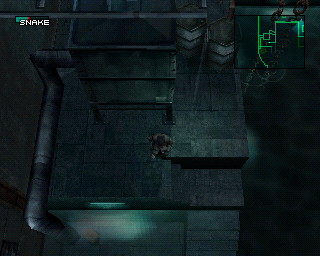 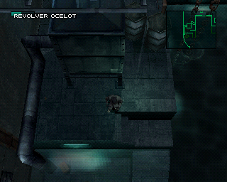

Option `--cartes` : les portes à carte s'ouvrent dès que la carte est dans l'inventaire, sans passer par le menu des objets pour l'équiper. Le niveau de la carte compte toujours (une carte LV.3 n'ouvre pas une porte LV.5). Pour qu'on voie que la carte a servi, elle s'équipe toute seule quand la porte s'ouvre : son icône (avec le niveau) apparaît dans la case objet, en bas à gauche, et y reste. Elle remplace donc l'objet que Snake avait en main, y compris quand c'est un garde qui ouvre la porte. Sur la plupart des portes, le voyant rouge et le « bip » de refus viennent maintenant dès qu'on présente une carte trop faible, équipée ou non. Trois portes (deux dans la salle du commandant, une au 2e sous-sol de l'immeuble des ogives) n'ont pas assez de place dans leur script : elles s'ouvrent sans équiper la carte, sans icône.

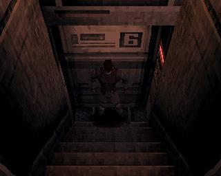 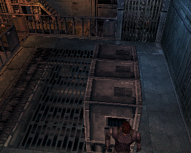

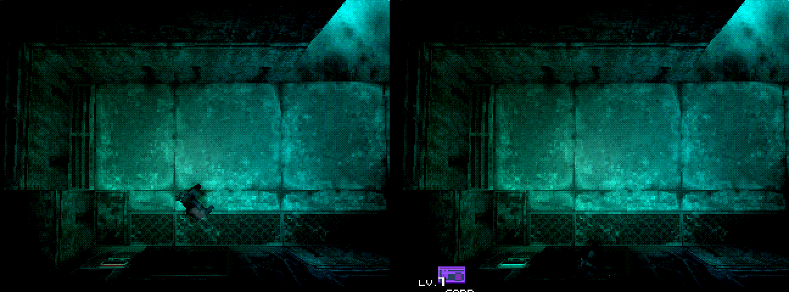

Option `--psg1loup` (désactivée par défaut) : après que Sniper Wolf a blessé Meryl dans le passage souterrain, plus besoin de retourner chercher le PSG1 à l'armurerie. Après l'appel de Campbell qui envoie chercher le PSG1, il suffit de ressortir dans la grotte des chiens-loups : le PSG1 attend **là où Meryl attendait avec le chien**. En le ramassant, Campbell rappelle comme à l'armurerie (« Tu as le PSG-1 ? Utilise-le contre Sniper Wolf… »), et au retour dans le passage Meryl n'est plus là : le combat commence, comme dans le jeu d'origine. Détail visible : le PSG1 est déjà dans l'inventaire (vide) en entrant dans la grotte, et la boîte apporte les balles. Le jeu n'a pas le modèle « arme au sol » dans cette salle, seulement celui des boîtes de munitions, qu'il refuse sans l'arme. La boîte apparaît aussi en mode Extreme ; le chemin par l'armurerie reste possible.

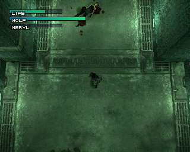

```bash
python cartes.py "Metal Gear Solid (VOSTFR) (Disc 1).bin" "Metal Gear Solid (VOSTFR) (Disc 2).bin"
python psg1loup.py "Metal Gear Solid (VOSTFR) (Disc 1).bin"
```

Option `--bandana` (prototype) : dans le jeu d'origine, équiper le BANDANA (munitions infinies, obtenu en finissant le jeu) ne se voit presque pas : le bandeau que Snake porte déjà devient juste un peu plus foncé. Avec l'option, le bandana a un **pan de 1,30 m** noué derrière la tête, comme dans MGS2 : il pend dans le dos quand Snake est immobile, se soulève derrière lui quand il court et ondule. C'est le petit modèle de pan que Konami avait laissé sur le disque sans jamais l'afficher, rallongé et animé. Animation simple : le pan suit la tête et ignore le décor (Snake couché, il peut passer dans le sol).

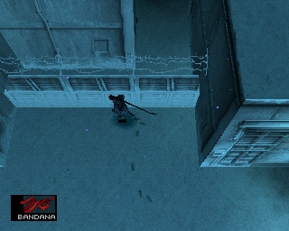 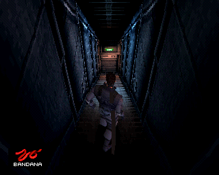

```bash
python bandana.py "Metal Gear Solid (VOSTFR) (Disc 1).bin" "Metal Gear Solid (VOSTFR) (Disc 2).bin"
```

Option `--titre` : l'écran titre devient celui de cette version. Sous « METAL GEAR », la bande claire porte **« SOLID - SHADOW FIXES »** (clin d'œil à Shadow Moses), avec les lettres refaites dans les couleurs d'origine, et **« by Soaresden  v1.0 »** s'affiche juste au-dessus du menu. Seules deux images du titre sont redessinées (le logo et le visage de Snake) ; le reste de l'écran ne change pas.

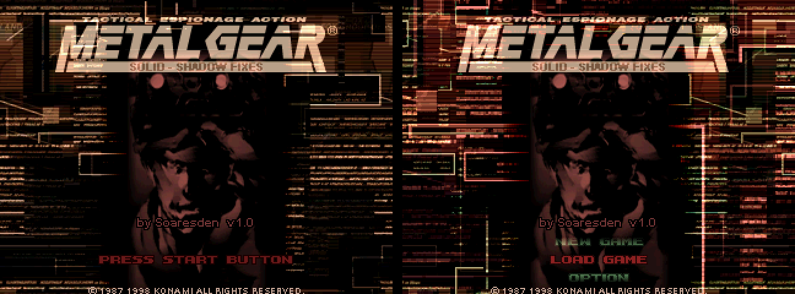

```bash
python titre.py "Metal Gear Solid (VOSTFR) (Disc 1).bin" "Metal Gear Solid (VOSTFR) (Disc 2).bin"
```

### Une seule image pour les émulateurs (« CD Combiner », option `--combine`)

`--combine` ajoute une image **« (1 CD) »** : tout le jeu sur un seul disque, **sans jamais changer de disque**. Le passage au disque 2 se fait tout seul, sans écran « Insérez le disque 2 » ; une sauvegarde du disque 2 se recharge directement.

⚠️ **Pour émulateurs seulement** (Batocera, DuckStation, SwanStation, RetroArch…) : l'image fait **~990 Mo**, elle ne tient pas sur un CD gravé (700 Mo). Sur une vraie PS1, garde les images 2 disques.

⚠️ **Le son est allégé**. Un CD ne peut pas dépasser 99 minutes : c'est la limite de l'adresse que le jeu donne au lecteur (et DuckStation refuse au-delà). Les deux disques font ~1,17 Go même en partageant ce qui est commun, alors qu'il faut tenir sous ~1,05 Go. Pour gagner la place :
- **voix** (Codec, voix en jeu) : 22 kHz → **11 kHz** ; on entend la différence (un peu plus étouffé), sans que ce soit gênant ;
- **cinématiques** : 33 kHz → **22 kHz** ; quasiment inaudible (elles n'ont presque rien au-dessus de 11 kHz) ;
- films (images d'archives), textes, sous-titres, graphismes : **inchangés**.

À écouter (même passage, avant / après) : voix du Codec [original](docs/previews/combine_codec_original.wav) · [allégé](docs/previews/combine_codec_allege.wav) — cinématique d'intro [original](docs/previews/combine_cinematique_original.wav) · [allégé](docs/previews/combine_cinematique_allege.wav).

```bash
python build.py --fr1 ... --uk1 ... --fr2 ... --uk2 ... --out ../work/out --combine      # VOSTFR (+ options au choix)
python combine.py "Metal Gear Solid (VOSTFR) (Disc 1).bin" "Metal Gear Solid (VOSTFR) (Disc 2).bin"   # à partir de 2 images déjà faites
```

Résultat : `Metal Gear Solid (VOSTFR) (1 CD).bin/.cue` (ou `(VF)`, `(EN)`), en plus des deux disques. Marche avec les trois versions et toutes les options. Compter 3 à 4 minutes de plus (réencodage du son). Les sauvegardes de la carte mémoire des images 2 disques marchent telles quelles.

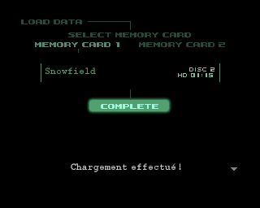 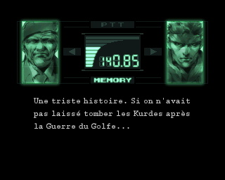

Donne les **deux disques** : la table du test sonore du disque 2 sert aussi à apparier exactement les voix du disque 1.

## Comment ça marche

### Cinématiques

Dans les deux versions PAL, chaque cinématique de `DEMO.DAT` a **exactement la même suite de blocs audio** (même nombre, même taille) : le doublage FR a été calé sur la durée des scènes. On garde le `DEMO.DAT` français (sous-titres, animations) et on y recopie l'audio anglais bloc par bloc. Les sous-titres FR tombent pile sur les répliques anglaises.

### Codec et voix en jeu

Là, les doublages n'ont pas la même durée : `VOX.DAT` anglais fait 196 Mo contre 182 Mo en français (disque 1).

1. **Appariement des voix** : les deux `VOX.DAT` rangent leurs ~1100 banques dans le même ordre, avec quelques banques en plus côté anglais. Le jeu contient une table de test sonore (`vc000101` → banque) aux mêmes noms en FR et en UK : appariement exact sur le disque 2, reporté sur le disque 1 par les banques communes aux deux disques. Le reste est aligné par programmation dynamique (durée audio, nombre de sous-titres), puis vérifié par les appels Codec du script.
2. **Nouveau `VOX.DAT`** : chaque banque anglaise (voix et mouvements de lèvres) reçoit les sous-titres français (même nombre de répliques que la banque FR, police FR), avec les horaires de la version anglaise. Dans le Codec, chaque sous-titre fait passer à la réplique suivante du script `RADIO.DAT` français : le texte suit donc la voix anglaise.
3. **Renumérotation** : les codes VOX (position dans le fichier) des commandes VOICE de `RADIO.DAT` et des scripts de `STAGE.DIR` sont réécrits. Dans `STAGE.DIR`, les scripts (bytecode GCL) sont lus exactement (`tools/gcx.py`) : seuls de vrais codes sont changés, jamais des données (textures, modèles). Le test sonore caché (stage `sound`) porte les codes du disque 2 : il n'est renuméroté que sur le disque 2.
4. **Image disque** : `VOX.DAT` grossit, donc `ZMOVIE.STR` et `DUMMY3M.DAT` sont décalés (secteurs bruts recopiés), les enregistrements de répertoire ISO 9660 et la taille du volume réécrits, EDC/ECC recalculés. Le jeu retrouve ses fichiers par leur nom au démarrage : aucune autre adresse à corriger.

Deux répliques du disque 2 n'existent qu'en français (dont une oubliée en allemand dans le disque FR) : elles restent en VF.

### Une seule image (`combine.py`)

1. **Son** : chaque banque de `VOX.DAT` et `DEMO.DAT` est décodée (ADPCM du SPU), filtrée et rééchantillonnée (filtre à coefficients entiers, résultat identique en Python et en JavaScript), réencodée, puis recollée avec ses sous-titres, mouvements de lèvres et données d'animation, qui ne changent pas. Les sous-titres sont calés sur une horloge, pas sur les échantillons : ils restent synchrones.
2. **Codes** : les voix et cinématiques sont désignées par leur position dans le fichier ; elles bougent, donc les codes de `RADIO.DAT` et des scripts de `STAGE.DIR` sont réécrits. Les scripts (bytecode GCL) sont lus exactement (`tools/gcx.py`) : aucun faux positif.
3. **Deux répertoires** : `MGS/` (disque 1) et `MGS2/` (disque 2) sur la même image. Le jeu cherche ses fichiers par nom au démarrage et à chaque changement de disque : l'EXE choisit le répertoire d'après le numéro de disque en cours. L'écran de changement de disque (overlays `change`, `abst`, `title`, `demosel`) n'attend plus le capot et donne au jeu le disque voulu. Le lecteur de voix du jeu ne connaissait pas 11 kHz : deux instructions retouchées.
4. **Image** : fichiers des deux disques à la suite (BRF.DAT et FACE.DAT, identiques, partagés), `DUMMY3M.DAT` (remplissage) retiré, tables ISO 9660 mises à jour : 420 719 secteurs, sous la limite de 449 850.

## Outils

| Script | Rôle |
|---|---|
| `tools/build.py` | Construit les images VOSTFR |
| `tools/chd2bin.py` | CHD v5 → BIN/CUE (cdlz, cdzl), vérification SHA-1 |
| `tools/psxiso.py` | Liste, extraction, vérification EDC d'une image PS1 |
| `tools/cdsector.py` | EDC/ECC Mode 2 Form 1 (numpy), réécriture d'un fichier en place |
| `tools/isorebuild.py` | Reconstruction d'une image avec des fichiers de taille différente |
| `tools/vox.py` | Banques de `VOX.DAT` / `DEMO.DAT` : blocs, sous-titres |
| `tools/voxalign.py` | Appariement des banques VOX françaises et anglaises |
| `tools/vox_vostfr.py` | Nouveau `VOX.DAT`, renumérotation de `RADIO.DAT` et `STAGE.DIR` |
| `tools/radio.py` | Script Codec `RADIO.DAT` (commandes TALK / VOICE) |
| `tools/demo_vostfr.py` | Remplacement de l'audio des cinématiques |
| `tools/carre.py` | Patch optionnel : Carré fait défiler le Codec |
| `tools/m9.py` | Patch optionnel : M9 et PSG1-T tranquillisants |
| `tools/psg1.py` | Patch optionnel : PSG1 debout ou accroupi |
| `tools/l2r2.py` | Patch optionnel : vue subjective, L2/R2 penchent, L2+R2 pointe des pieds |
| `tools/fps.py` | Patch optionnel : tirer au SOCOM / M9 en vue subjective |
| `tools/life.py` | Patch optionnel : texte à la place de « LIFE » dans la barre de vie (+ aperçu) |
| `tools/cartes.py` | Patch optionnel : portes à carte ouvertes sans équiper la carte, qui s'équipe alors toute seule |
| `tools/psg1loup.py` | Patch optionnel : le PSG1 dans la grotte, là où Meryl attendait, avant Sniper Wolf |
| `tools/bandana.py` | Patch optionnel : bandana visible, très long pan animé (comme MGS2) |
| `tools/titre.py` | Patch optionnel : écran titre « Shadow Fixes », by Soaresden, v1.0 |
| `tools/combine.py` | Les 2 disques en une seule image (son allégé, pas de changement de disque) ; aussi dans la page web (case « CD Combiner ») |
| `tools/spuadpcm.py` | ADPCM du SPU : décodage, encodage, rééchantillonnage entier |
| `tools/gcx.py` | Lecture exacte des scripts GCX de `STAGE.DIR` (codes des voix et des cinématiques) |
| `tools/mips.py` | Petit assembleur MIPS (R3000) pour les patchs |
| `tools/pal.py` | Version de l'EXE (PAL France ou PAL Europe anglaise) et traduction des adresses des patchs |
| `tools/palmap.py` | Outil de développement : génère `tools/pal_uk.py` (adresses FR → UK) |
| `tools/emu.py`, `tools/emu_drive.lua` | Test automatique dans PCSX-Redux (captures d'écran) |
